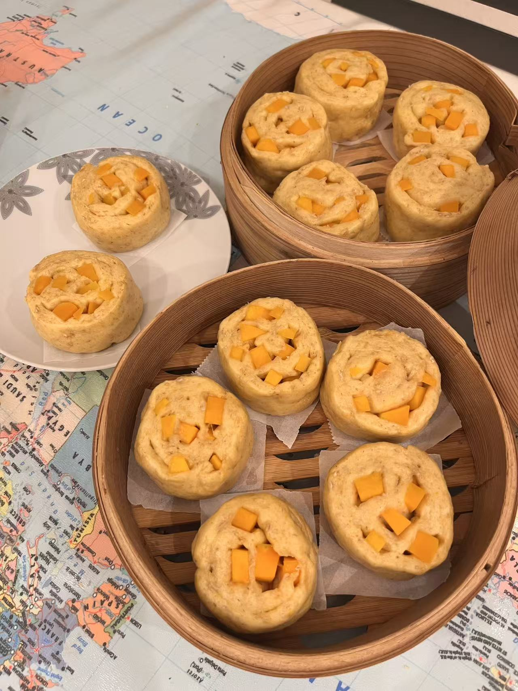
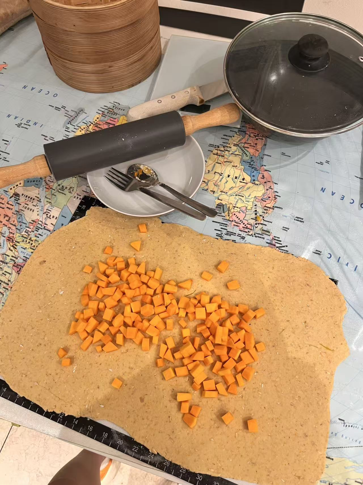
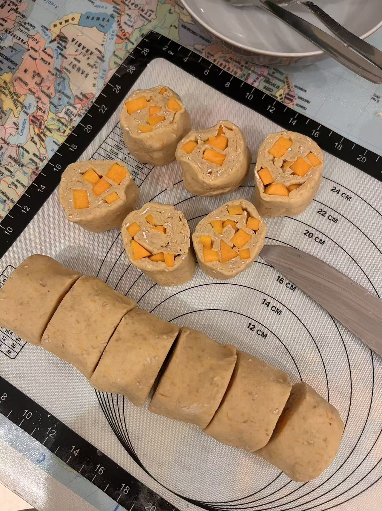

# Pumpkin Mantou 南瓜馒头

---

## 配料准备

| Ingredient 食材 | Amount 用量 | Side Note 备注 / 处理方式 |
| :--- | :--- | :--- |
| All-purpose flour 中筋面粉 | 300g | |
| Yeast 酵母 | 3g | |
| Pumpkin 南瓜 | half 半个 | Half steamed and mashed, half cut into small cubes 一部分蒸熟，一部分切小丁 |
---

## 步骤说明

1. **Dough 和面**

   I am a lazy person, and lazy people have their own method! First, steam the pumpkin until soft and mash about 200g of it. Add the pumpkin puree to the flour; because pumpkin contains a lot of moisture, you usually do not need extra water. Knead the dough until it comes together, then let it rest in the fridge for 20 minutes. Take it out, knead lightly again, and return it to the fridge for another 20 minutes. The exact timing depends on the dough and the room temperature; as long as it has some stretch and feels soft and easy to handle, it is good to go. For the late yeast method, add the yeast after the dough is already mixed: dissolve it in a little water until smooth, spread it into the dough, and knead until evenly incorporated. If the yeast slurry is too thin, add a little more flour to adjust it.

    我是懒狗，懒狗只做后酵母一发面食！首先把南瓜切成薄片蒸熟，切得越薄熟的越快。大概称出200g的南瓜泥，放进面粉里，因为南瓜水分很足，不需要另外再加水了。下手揉面絮，成团后放进冰箱醒面二十分钟。水和好后拿出来稍微揉一下，再放近冰箱醒二十分钟。具体时间长短看面团状态和气温，只要有一定延展性，非常软又好rua就行。后酵母发就是把酵母在揉好面之后加进去，稍微用一点点水和成泥，涂进面团里面，再揉均匀。这一步如果酵母水太稀了，可以再呛一点面粉进去。

2. **Shaping 整形**

   Keep the remaining pumpkin in small cubes and use it as the filling; the amount is up to you. Roll the dough into a thin sheet, then roll it up to create layers. Spread the pumpkin cubes on top, roll it up again, and gently flatten the seam so it seals well. Cut it into cute little buns. Use the leftover dough to fill a bottle cap so you can monitor the fermentation.
   
   剩下一部分切成小丁的生南瓜做馅，放多少都可以。摊成面片，稍微薄一点卷起来更有层次，把南瓜丁铺上去，再卷起来，接口的地方稍微擀得薄一点，切成可爱的小胖墩子。用边角料填一个瓶盖来观察发酵状态。

3. **Proofing 发酵**

    Proof for about 40 minutes. The dough in the bottle cap should rise to about 1.5 times its original height, and when you lift it, it should feel light and airy.
    
    大概发酵四十多分钟，瓶盖里的面团鼓起到1.5倍高，面团掂起来轻飘飘的感觉确实气就没毛儿了！

4. **Steaming 烫死它们**

    If you steam them from cold water, the dough can proof a little more while the water heats up. Steam for 15 minutes, then let them sit covered for another 3 minutes before eating.
    
    凉水上锅蒸的话可以再促进发酵一会儿，蒸十五分钟焖三分钟就可以开吃啦！

