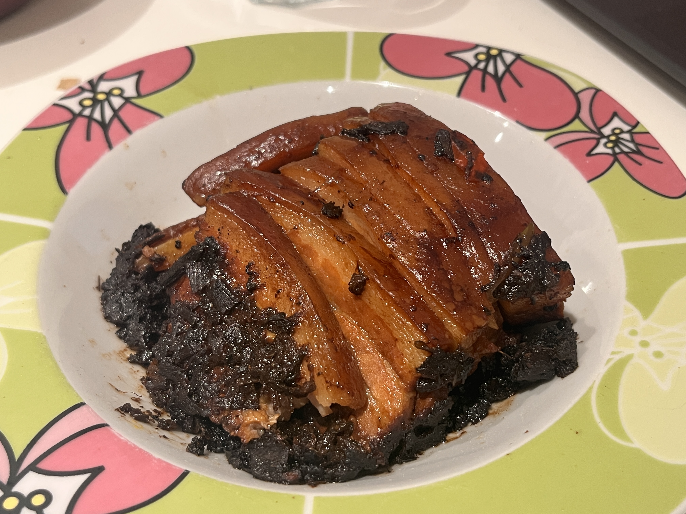

# Braised Pork with Preserved Vegetables 梅菜扣肉

---

## 配料准备

| Ingredient 食材 | Amount 用量 | Side Note 备注 / 处理方式 |
| :--- | :--- | :--- |
| Pork belly 五花肉 | 1.5kg | |
| Preserved mustard greens 梅菜 | 200g | I used 150g; it felt a little light 我只放了150g，感觉有点少 |
| Star anise 八角 | 3 pieces | for braising 煮肉 |
| Bay leaf 香叶 | 2 pieces | for braising 煮肉 |
| Ginger 姜 | 5 pieces 五片 | for braising 煮肉 |
| Sichuan pepper 花椒 | a pinch 一捏 | for braising 煮肉 |
| Chi Hou sauce 柱候酱 | 1 tablespoon 一大勺 | marinade 腌料 |
| Hoisin sauce 海鲜酱 | 2 tablespoons 两勺 | marinade; original recipe uses 4, but I found it too sweet 腌料，原配方五勺，我觉得太甜了 |
| Fermented red tofu 红腐乳 | 1 block + 1 spoon of juice 一块和一勺汁 | marinade 腌料 |
| Peanut butter 花生酱 | 1 spoon 一勺 | marinade 腌料 |
| Light soy sauce 生抽 | 2 spoons 两勺 | marinade 腌料 |
| Dark soy sauce 老抽 | 3 spoons 三勺 | marinade 腌料 |
| Oyster sauce 耗油 | half spoon 半勺 | marinade 腌料 |

---

## 步骤说明

1. **Blanching and braising 焯水+炖肉**

   First blanch the pork and cleanly remove all the blood foam, Then add star anise, bay leaves, ginger slices, and Sichuan pepper. Braise for about 40 minutes, until a chopstick can go through with a little resistance. Reserve a bit of the braising liquid. In general, people also fry the pork to get the tiger-skin. I was too lazy, and honestly, besides making it look a little nicer, it does not change the flavor much, so I skipped it. If you want the tiger-skin look, be careful not to get splashed by hot oil.

   先焯水，把血沫捞干净一点，放八角香叶姜片和花椒，煮40分钟到筷子能有阻力地插透。留一点点煮肉的汤汁。一般来说还会把肉炸出虎皮，我太懒了，而且其实除了长得好看一点，味道上没啥区别，我就省略了，大家要是追求虎皮，要注意别被油溅伤。

2. **Preparing the preserved mustard greens 处理梅菜**

    Soak the preserved mustard greens in water for 20 minutes. If they are very dry, use warm water; otherwise, cool water is fine. Rinse them several times to remove excess salt, then drain as much as possible. Put them in a dry wok without oil and stir-fry until fragrant and dry. I also added a few chilies in this step.

    梅菜先泡水20分钟，很干的梅菜用温水泡，一般用凉水就行。跑完之后多清洗几遍，洗掉多余的盐后，尽量控干水份。空锅不放油，把梅菜煸炒到干香，我还放了几个辣椒进去。

3. **Shaping and marinating 整形+腌制**

    Trim the pork so the piece is evently high. Cut the trimmings and the neatly cut meat into slices about the width of a chopstick. Toss them in the marinade and mix well so each piece gets coated. Arrange the pork slices skin-side down at the bottom of a bowl, then place the remaining scraps on top. Mix the remaining marinade with the dry stir-fried preserved greens, then add 5 spoonfuls of the braising liquid and stir until well combined. Layer this mixture on top of the pork.

    肉尽量修剪得高度一致，把切下的边角料和整齐的肉都改刀成一根筷子宽的片。放进腌料里搅拌一下，保证每个肉片都沾上酱汁。肉片皮朝下码放在碗底，剩余的边角料放上去。剩下的腌料用来拌炒干的梅干菜，再加入5勺煮肉的汤汁拌匀，码在肉上。

4. **Steaming 烫死它**

    Cover with heat-safe plastic wrap or foil; it is best not to use a plate, because that affects heat transfer. Steam for two hours. Yes, you read that correctly — two full hours! The fat will become incredibly soft and tender, and the lean meat will not be tough at all; it basically melts in your mouth! A pressure cooker would be faster, but I sadly do not have a pressure cooker license. In my opinion, steamed dishes can end up a little watery and bland, so after reheating in the microwave on high, the sauce reduces slightly and stickes onto the meat, making it taste even better.

    盖上耐高温的保鲜膜或者锡纸，最好不要扣盘子，会影响导热。蒸制两个小时，是的，你没有看错，就是两个小时！肥肉就能无敌软烂，瘦肉完全不柴，口感特别特别好。有高压锅当然是更快，但是本人没有高压锅驾驶证。个人认为，蒸出来的水分大，有点寡淡，反而用微波炉高火复热后，汤汁稍微浓缩了并且扒在肉上的味道更好！
    