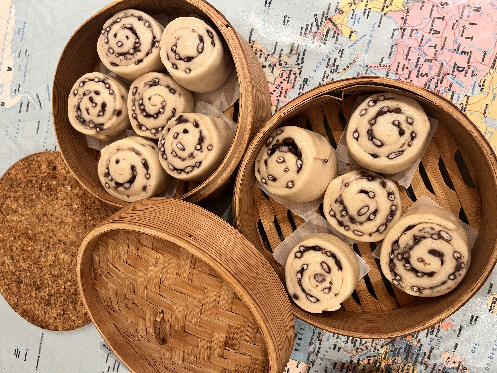

# Red Bean Rice-Wine Mantou 红豆酒酿馒头

---

## 配料准备

| Ingredient 食材 | Amount 用量 | Side Note 备注 / 处理方式 |
| :--- | :--- | :--- |
| All-purpose flour 中筋面粉 | 300g | |
| Yeast 酵母 | 3g | |
| Red bean adzuki bean 赤小豆 | 100g | Soak the night before, then cook in the rice cooker using the normal rice mode twice 提前一天泡水，电饭煲两次煮饭程序煮熟 |
| Rice wine starter 酒酿 | 160g | Includes the rice and liquid; add water as needed because the rice-to-water ratio varies 连水带米的重量，因为具体米水比例不定，要视情况加水 |
---

## 步骤说明

1. **Dough 和面**

   I am a lazy person, and lazy people only do one-rise dough! Use the rice wine starter to knead the dough and add water only as needed, depending on the texture. Knead until the mixture is shaggy, then let it rest in the fridge for 20 minutes. Take it out, knead lightly again, and return it to the fridge for another 20 minutes. The exact timing depends on the dough and the room temperature; as long as it has some stretch and feels soft and easy to handle, it is good to go. For the late-yeast method, add the yeast after the dough is already mixed: dissolve it in a little water until smooth, spread it in the dough, and knead until evenly incorporated. If the yeast slurry is too thin, add a little more flour to adjust it.

    我是懒狗，懒狗只做后酵母一发面食！用酒酿揉面，看面团情况，视情况加清水。下手揉面絮，成团后放进冰箱醒面二十分钟。水和好后拿出来稍微揉一下，再放近冰箱醒二十分钟。具体时间长短看面团状态和气温，只要有一定延展性，非常软又好rua就行。后酵母发就是把酵母在揉好面之后加进去，稍微用一点点水和成泥，涂进面团里面，再揉均匀。这一步如果酵母水太稀了，可以再呛一点面粉进去。

2. **Shaping 整形**

   Drain the red beans well; if they are too wet, the dough will break apart (trust me on this one). I originally wanted to make individual tongue-shaped rolls, but because I had a lot of red beans and did not dry them enough, the dough collapsed. So I switched back to the usual one-large-sheet and rolled everything up. Spread the red beans on the dough in a moderate amount; I used about 80% of the recipe amount because the filling was wet. If it feels too wet, add a little flour to absorb the moisture. Roll it up, gently flatten the seam, and cut into cute little buns. Use the leftover dough scraps to fill a bottle cap so you can monitor the fermentation.
   
   红豆尽量沥干水分，不然会让面团直接泻开（别问我怎么知道的）。本来想单个做成牛舌卷，但是就是因为这个配方的红豆太多，我又忘记把水控干，直接翻车。还是只能摊成一整块的面片卷。摊成面片后，看情况放红豆，我就只放了配方大概80%的红豆。因为太湿了，我还呛了很多面粉进去吸水。最后再卷起来，接口的地方稍微擀得薄一点，切成可爱的小胖墩子。用边角料填一个瓶盖来观察发酵状态。

3. **Proofing 发酵**

    Proof for about 40 minutes. The dough in the bottle cap should rise to about 1.5 times its original height, and when you lift it, it should feel light and airy.
    
    大概发酵四十多分钟，瓶盖里的面团鼓起到1.5倍高，面团掂起来轻飘飘的感觉确实气就没毛儿了！

4. **Steaming 烫死它们**

    If you steam them from cold water, the dough can proof a little more while the water heats up. Steam for 15 minutes, then let them sit covered for another 3 minutes before eating. Because different rice wine starters vary, the final wine flavor may not be very strong, but you can still taste a gentle sweet-sour note, especially when the buns are warm but not piping hot. 
    
    凉水上锅蒸的话可以再促进发酵一会儿，蒸十五分钟焖三分钟就可以开吃啦！因为酒酿不同，做出来酒酿的味道不一定很浓，但是能吃出淡淡的酸甜味，特别是半凉的时候，味道更加明显。