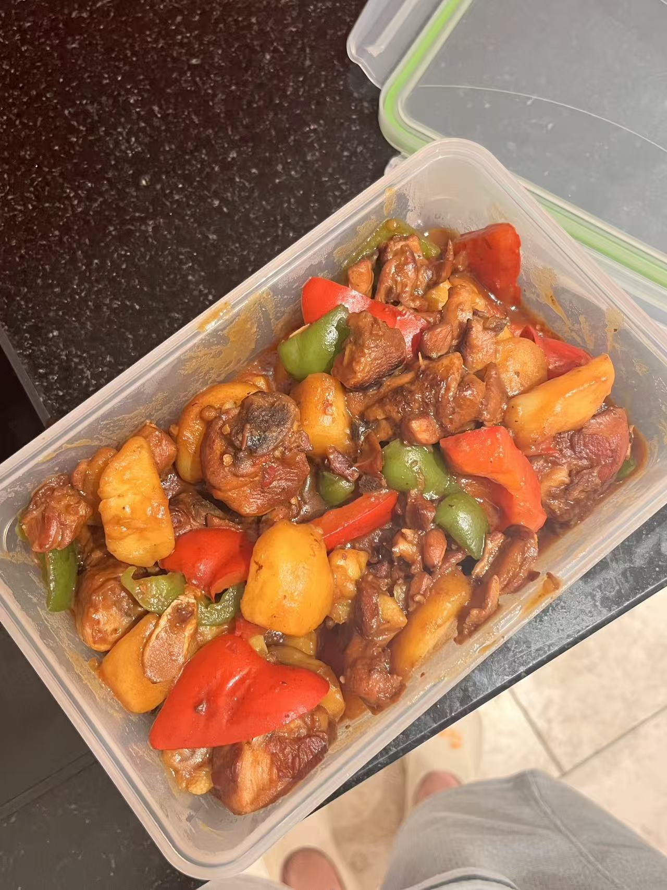

# Yellow Bean Sauce Braised Chicken 黄焖鸡

---

## 配料准备

| Ingredient 食材 | Amount 用量 | Side Note 备注 / 处理方式 |
| :--- | :--- | :--- |
| Chicken 鸡肉 | 500g (~ two legs 大概两个鸡腿) | Blanching optional 焯不焯水都可以 |
| Mushroom 蘑菇 | 3 三朵 | |
| Potato 土豆 | 2 两个 | |
| Red and green peppers 青红椒 | 2 两个 | |
| Yellow bean sauce 黄豆酱 | 1 tablespoon 一大勺 | Must-have 必不可少 |
| Oyster sauce 蚝油 | 3 tablespoons 三勺 |  |
| Light soy sauce 生抽 | 3 tablespoons 三勺 |  |
| Peanut butter 花生酱 | 1 tablespoon 一勺 |  |

> 💡 **Note**：Feel free to add anything you like, such as meatballs, tofu, or other vegetables besides potatoes and mushrooms. 还可以加肉丸，豆腐，蔬菜等，小馋猫，你就吃吧。

---

## 步骤说明

1. **Kill the chicken 炒鸡**

   The sugar color is optional: if you want to be more authentic, melt 15g of sugar first until it turns deep amber, then add the chicken that has been drained well. Stir-fry a bit longer until the chicken turns lightly golden, then add the ginger and garlic. Once the smell of ginger and garlic occurs, pour in the sauce mentioned above and enough water to just cover the chicken.

   个人觉得糖色可有可无，讲究的可以用15g冰糖先炒个糖色，等到糖色出现密集的泡泡后，下控干水分的鸡肉。多炒一会儿，把鸡肉炒到微焦后放葱姜，爆出葱姜的香味后倒入酱料和没过鸡肉的清水。

2. **Simmering 煮制**

    Add your favorite vegetables and ingredients. If you include potatoes, cook a little longer. At the end, add 1 spoon of peanut butter and the green/red peppers, then reduce over high heat until the sauce thickens. The method and flavor are actually very similar to chicken claypot, but this is more savory and aromatic, while the other one is a bit sweeter; it depends on personal taste. In the end, both are rice killers.

    放入喜欢的配菜，如果放了土豆就要多煮一会儿。最后加入一勺花生酱和青红椒，大火收汁。做法和味道其实和鸡公煲很像，但是这个会比较咸香，那个更甜一些，看个人口味。两个都是米饭杀手来的。
   